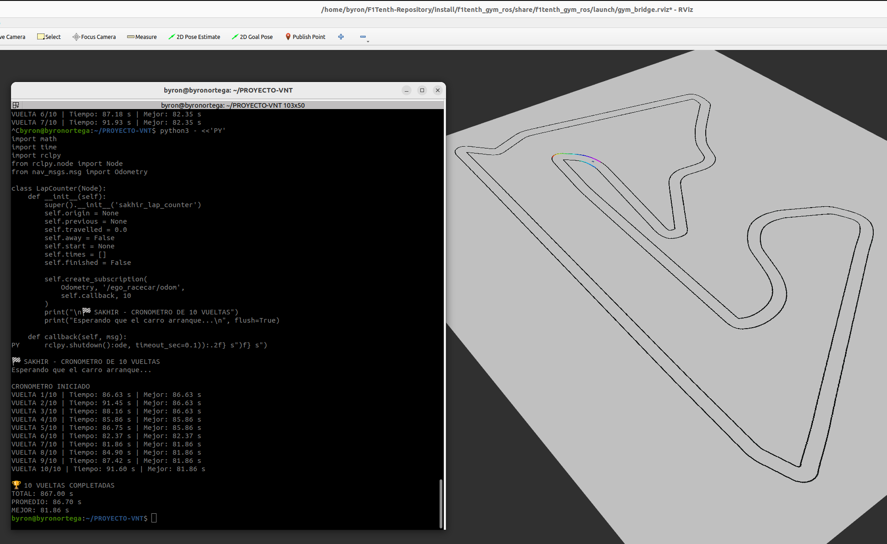
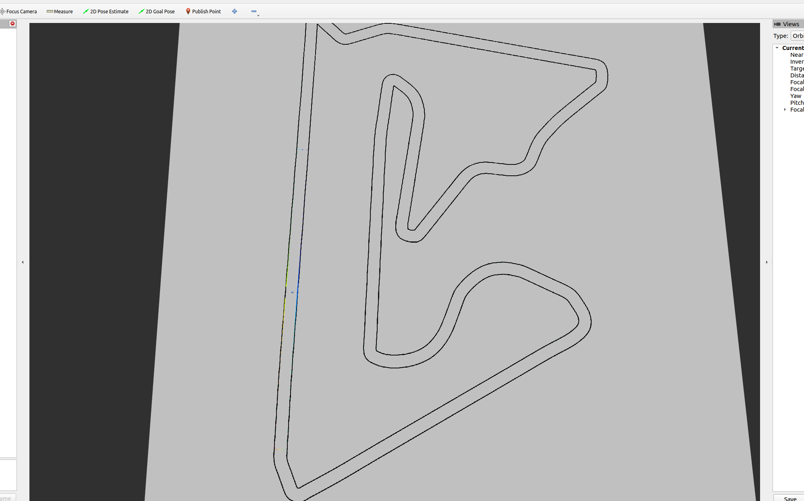
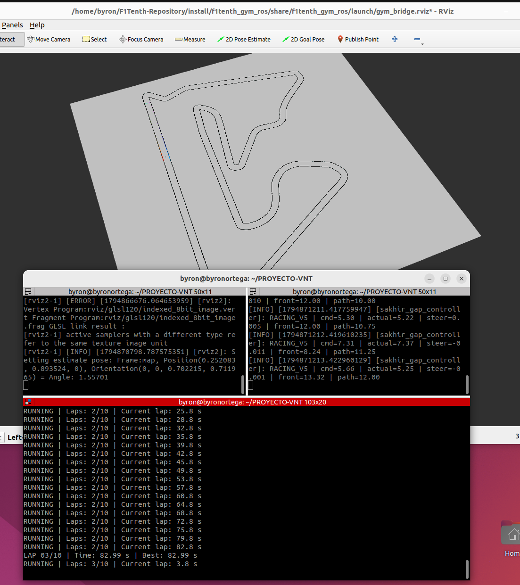

# F1TENTH Autonomous Racing — Sakhir Circuit

<p align="center">
  
</p>

<p align="center">
  
  
  
  
</p>

**Author:** Byron Ortega  
**Project:** PROYECTO-VNT  
**Platform:** Ubuntu 22.04, VMware, ROS 2 Humble  
**Circuit:** Sakhir  
**Navigation:** Reactive Follow the Gap

---

## 1. Project Overview

This repository contains the first stage of an autonomous racing project developed using F1TENTH Gym and ROS 2 Humble.

The vehicle uses LiDAR measurements to navigate the Sakhir circuit without manual steering.

The primary challenge is to complete ten consecutive laps without collisions while optimizing stability and lap times.

## 2. Project Requirements

The implementation includes:

- Reactive Follow the Gap navigation.
- LiDAR-based obstacle detection.
- Ackermann steering control.
- Adaptive vehicle speed control.
- Automatic lap counting.
- Individual lap-time measurement.
- A ten-lap racing demonstration.

## 3. Sakhir Circuit



The circuit contains long straight sections, sharp corners, and narrow turns that challenge vehicle stability and trajectory selection.

## 4. Reactive Follow the Gap Algorithm

The controller processes the LiDAR scan to select a safe driving direction.

### Processing Pipeline

1. Receive measurements from `/scan`.
2. Filter invalid LiDAR readings.
3. Detect depth discontinuities.
4. Extend obstacle boundaries using Disparity Extender.
5. Identify navigable gaps.
6. Select a stable target heading.
7. Calculate Ackermann steering.
8. Evaluate obstacle clearance along the predicted path.
9. Adapt speed according to curvature and clearance.
10. Publish vehicle commands through `/drive`.

### LiDAR Navigation


### Steering and Speed Optimization

The controller includes several improvements:

- Stable gap selection.
- Corridor-centering assistance.
- Adaptive steering response.
- Steering-rate limits.
- Path-clearance estimation.
- Curvature-dependent speed control.
- Acceleration and braking management.

These improvements were developed to reduce steering oscillation and improve cornering performance.

## 5. Controller Code Structure

| File | Purpose |
|---|---|
| `gap_controller.py` | Reactive navigation, steering, and speed control |
| `lap_timer.py` | Automatic lap detection and individual lap timing |
| `setup.py` | ROS 2 Python package configuration |
| `package.xml` | ROS 2 package metadata and dependencies |
| `Sakhir_map.yaml` | Sakhir map configuration |
| `Sakhir_map.png` | Sakhir occupancy map |

A detailed explanation is provided in
[Controller Tutorial](docs/CONTROLLER_TUTORIAL.md).

## 6. Vehicle Parameters

| Parameter | Value |
|---|---|
| Wheelbase | 0.3302 m |
| Width | 0.31 m |
| Length | 0.58 m |
| Steering limit | Approximately 0.4189 rad |

## 7. Installation

Requirements:

- Ubuntu 22.04
- ROS 2 Humble
- Python 3 and NumPy
- F1TENTH Gym ROS simulator

Clone and build this repository:

```bash
git clone https://github.com/Byron-00/PROYECTO-VNT.git
cd PROYECTO-VNT

source /opt/ros/humble/setup.bash

colcon build --packages-select sakhir_gap_controller --symlink-install
source install/setup.bash
```

The F1TENTH Gym ROS simulator is installed separately.

## 8. Map Configuration

Copy `maps/Sakhir_map.png` and
`maps/Sakhir_map.yaml` into the simulator's map directory.

Update the simulator's `sim.yaml`:

```yaml
map_path: '/home/YOUR_USERNAME/F1Tenth-Repository/src/f1tenth_gym_ros/maps/Sakhir_map'
map_img_ext: '.png'
```

Replace `YOUR_USERNAME` with the local Ubuntu username.

## 9. Running the Project

Open three terminal windows.

### Terminal 1 — Simulator

```bash
source /opt/ros/humble/setup.bash
source ~/F1Tenth-Repository/install/setup.bash
ros2 launch f1tenth_gym_ros gym_bridge_launch.py
```

Place the vehicle at the chosen starting position.

### Terminal 2 — Lap Counter and Timer

Start this terminal before the controller:

```bash
source /opt/ros/humble/setup.bash
source ~/PROYECTO-VNT/install/setup.bash

python3 ~/PROYECTO-VNT/src/sakhir_gap_controller/sakhir_gap_controller/lap_timer.py
```

### Terminal 3 — Reactive Controller

```bash
source /opt/ros/humble/setup.bash
source ~/PROYECTO-VNT/install/setup.bash

ros2 run sakhir_gap_controller gap_controller --ros-args \
-p max_speed:=9.0 \
-p max_lateral_accel:=7.5 \
-p brake_accel:=7.0 \
-p drive_accel:=8.5 \
-p lookahead_base:=1.00 \
-p lookahead_gain:=0.08 \
-p bubble_radius:=0.30 \
-p gap_weight:=3.0
```

These parameters are an example configuration. For reproducing the final run, use the exact parameters recorded during the successful ten-lap test.

## 10. Automatic Lap Counting and Timing

The `lap_timer.py` node subscribes to `/ego_racecar/odom`.

It creates a virtual finish line using the vehicle's initial position and orientation.

A completed lap is detected when the vehicle returns to and crosses the finish line in the correct direction, after traveling around the track.

The system displays:

- Current lap number.
- Individual lap time.
- Best lap time.
- Total time for ten laps.
- Average lap time.

The timer measures wall-clock elapsed time, not an official simulator race clock.

The lap counter must be started with the vehicle stationary at the chosen starting position.

## 11. Part 1 — Experimental Results

The controller completed ten consecutive laps during testing.

The development process focused on reducing steering oscillation, improving cornering performance, and optimizing average lap time.

### Racing Screenshot


### Complete Ten-Lap Demonstration

**[Watch the Ten-Lap Racing Video](media/ten-laps.webm)**

The evidence recording must display the vehicle, automatic lap counter, and lap-time output.

## 12. ROS 2 Topics

| Topic | Message Type | Purpose |
|---|---|---|
| `/scan` | `sensor_msgs/msg/LaserScan` | LiDAR input |
| `/drive` | `ackermann_msgs/msg/AckermannDriveStamped` | Vehicle control |
| `/ego_racecar/odom` | `nav_msgs/msg/Odometry` | Position and speed feedback |

## 13. Future Work — Part 2

The next stage will introduce additional obstacles to the Sakhir racing environment.

Planned improvements include:

- Obstacle detection and reactive avoidance.
- Improved trajectory selection.
- Faster cornering without collisions.
- Additional racing performance evaluation.

## 14. References

- [F1TENTH Official Website](https://f1tenth.org/)
- [F1TENTH Gym](https://github.com/f1tenth/f1tenth_gym)
- [F1TENTH Gym ROS](https://github.com/f1tenth/f1tenth_gym_ros)
- [ROS 2 Humble Documentation](https://docs.ros.org/en/humble/)

---

**Developed by Byron Ortega — PROYECTO-VNT**


## Lap Counter and Timing Evidence


