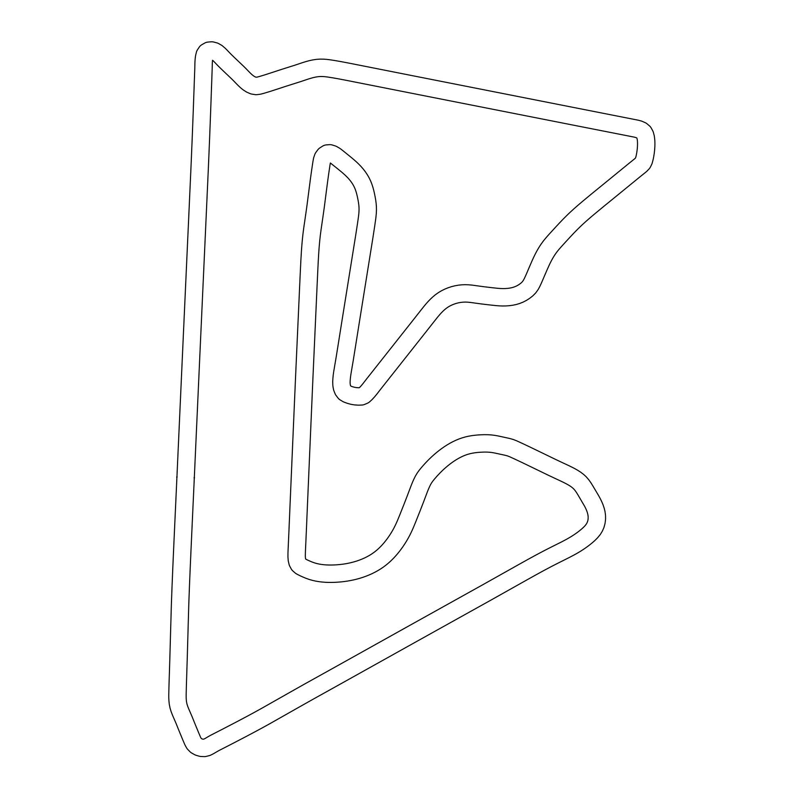
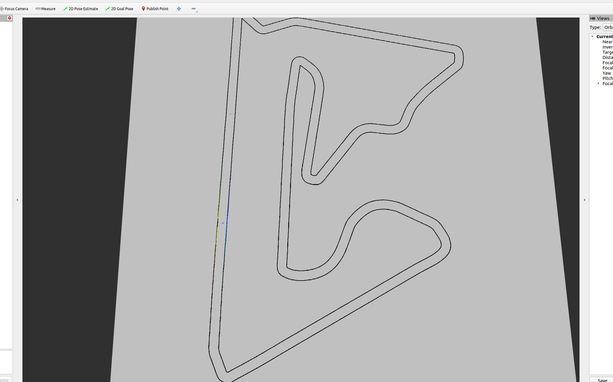

# Proyecto VNT — F1TENTH

**Autor:** Byron Ortega Salinas  
**Asignatura:** Vehículos No Tripulados  
**Entorno:** Ubuntu 22.04, ROS 2 Humble, VMware  
**Pista asignada:** Sakhir

## 1. Introducción

Este repositorio documenta el desarrollo de un controlador de navegación autónoma para el simulador F1TENTH, como parte del proyecto del primer parcial de Vehículos No Tripulados.

En la primera parte se implementará un controlador reactivo basado en el algoritmo *Follow the Gap*, que utiliza las mediciones del sensor LiDAR para identificar espacios libres y determinar los comandos de velocidad y dirección del vehículo.

## 2. Objetivos

- Implementar un controlador Follow the Gap en ROS 2 Humble.
- Completar diez vueltas consecutivas sin colisiones.
- Reducir el tiempo de recorrido de una vuelta.
- Evaluar el comportamiento del controlador en la pista Sakhir.
- Documentar el desarrollo, las pruebas y los resultados.

## 3. Herramientas

- Ubuntu 22.04 LTS.
- ROS 2 Humble.
- VMware.
- F1TENTH Gym y RViz.
- Python y rclpy.
- Git y GitHub.

## 4. Pista de competencia: Sakhir

La pista Sakhir se utilizará como escenario de las pruebas de navegación autónoma.

## 5. Desarrollo del proyecto

La implementación se organizará en etapas: preparación del entorno, configuración del mapa, programación del controlador, pruebas de conducción y evaluación del rendimiento.

Se configuró el simulador F1TENTH en ROS 2 Humble, utilizando el mapa Sakhir para las pruebas de navegación autónoma.

La siguiente captura muestra el entorno de simulación y el circuito que se utilizará durante la implementación del controlador Follow the Gap.

## 6. Resultados

*Se incorporarán las evidencias de simulación, los registros de vueltas, los tiempos y las observaciones obtenidas durante las pruebas.*

## 7. Próximas etapas

El repositorio se mantendrá organizado para integrar la segunda parte del proyecto sin modificar innecesariamente el trabajo ya desarrollado.
