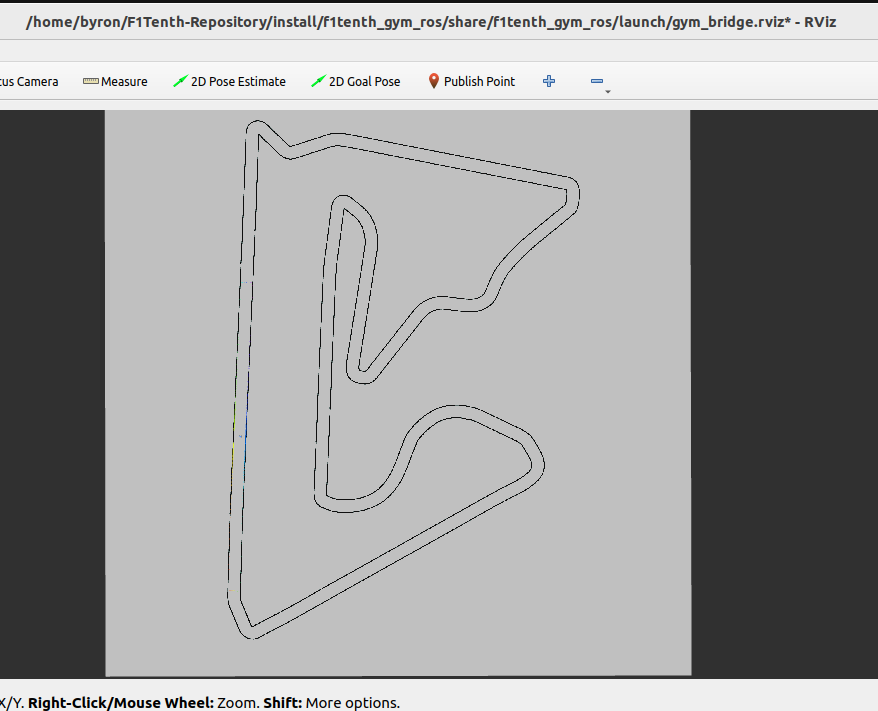
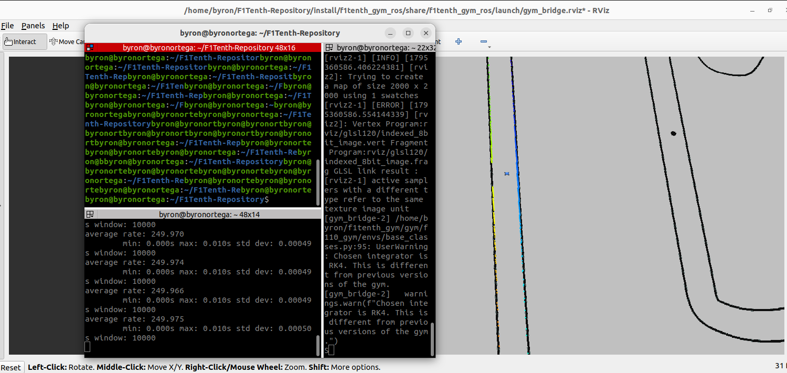
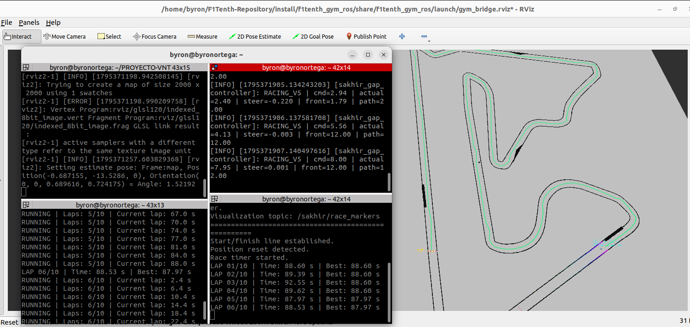
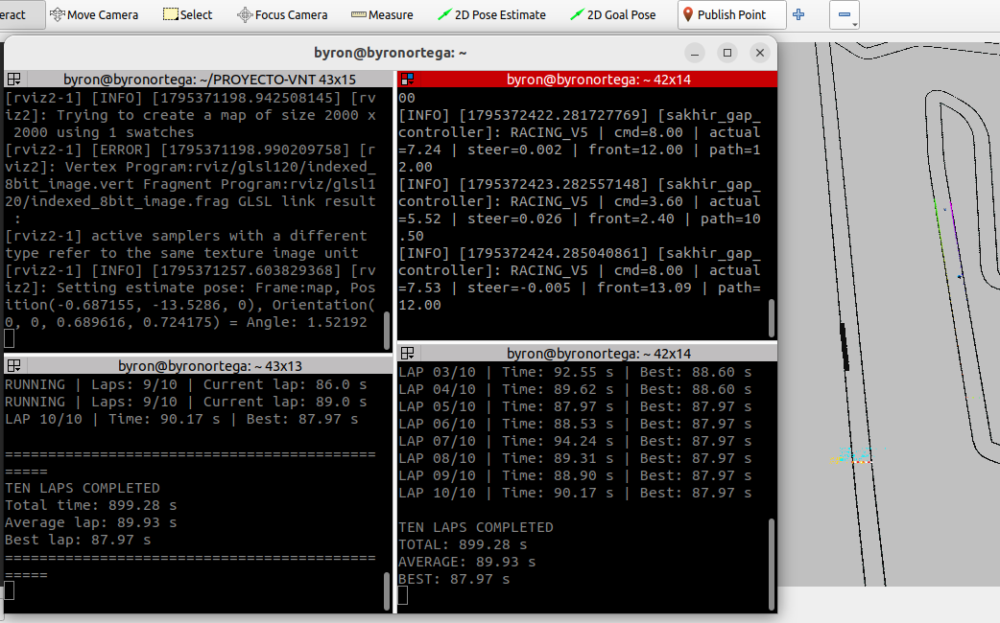
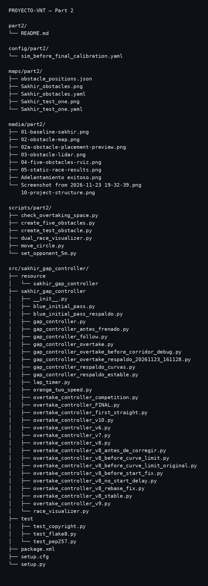

# F1TENTH Autonomous Racing — Part 2

## 1. Static Obstacle Avoidance and Autonomous Overtaking

**Author:** Byron Ortega  
**Project:** PROYECTO-VNT  
**Platform:** Ubuntu 22.04, ROS 2 Humble  
**Simulator:** F1TENTH Gym ROS  
**Circuit:** Sakhir  
**Navigation:** Reactive Follow the Gap  

---

## 2. Project Overview

Part 2 extends the autonomous racing system
developed during Part 1.

The objective is to improve the reactive controller
so that it can avoid static obstacles and perform
autonomous overtaking maneuvers.

The project includes two competition trials:
static obstacle avoidance and dynamic obstacle
avoidance with two autonomous vehicles.

The stable Part 1 controller is preserved as
the starting point for further development.

**[View Part 1 Documentation](../README.md)**

---

## 3. Competition Requirements

### Trial 1 — Static Obstacle Challenge

Five static obstacles must be placed on the
assigned racing circuit.

The autonomous vehicle must successfully
complete **10 consecutive laps without collisions**.

The objective is to evaluate obstacle detection,
reactive avoidance, steering stability, and
speed control.

### Trial 2 — Dynamic Obstacle and Overtaking

A second autonomous vehicle must be introduced
into the simulation.

The second vehicle must start **5 meters ahead**
of the primary vehicle.

The primary vehicle must autonomously overtake
the second vehicle, which acts as a dynamic obstacle.

Both vehicles must use autonomous control
algorithms developed during Part 1.

Both vehicles must complete **10 consecutive
laps without collisions**.

---

## 4. Development Environment

The project uses:

- Ubuntu 22.04
- ROS 2 Humble
- Python 3
- F1TENTH Gym ROS
- LiDAR-based navigation
- Ackermann steering
- RViz visualization

### Environment Installation

The simulation installation tutorial is available at:

[F1TENTH Installation Repository](https://github.com/widegonz/F1Tenth-Repository)

---

## 5. Development Strategy

The project will be developed and validated
through independent stages.

| Stage | Objective | Status |
|---|---|---|
| 1 | Repository and documentation setup | In progress |
| 2 | Five static obstacles on Sakhir | Planned |
| 3 | LiDAR detection and avoidance | Planned |
| 4 | Ten collision-free laps | Planned |
| 5 | Second autonomous vehicle | Planned |
| 6 | Independent vehicle controllers | Planned |
| 7 | Dual-vehicle RViz visualization | Planned |
| 8 | Autonomous overtaking | Planned |
| 9 | Final ten-lap competition | Planned |

Only completed and verified experiments will
be marked as successful.

---

## 6. Static Obstacle Implementation

### Original Sakhir Configuration

The original Sakhir simulation was inspected
before introducing obstacles.

| Parameter | Value |
|---|---|
| Map | `Sakhir_map` |
| Resolution | `0.05695 m/pixel` |
| Active vehicles | `1` |
| Initial vehicle position | `(0.0, 0.0)` |
| Original map | Preserved |
| Obstacle map | Working copy created |

### Original Circuit



### Obstacle Map Preparation

A separate working copy was created:

- `maps/part2/Sakhir_obstacles.png`
- `maps/part2/Sakhir_obstacles.yaml`

The original map and simulator configuration
remain unchanged.

Obstacle placement and simulation validation
are pending.


---


### First Static Obstacle — Initial Test

A preliminary test was prepared using a modified
copy of the original Sakhir occupancy map.

The obstacle was placed on a straight section
of the circuit using an interactive Python tool.

**Implementation details:**

- Original circuit: Sakhir
- Obstacle type: Circular static obstacle
- Obstacle radius: 0.20 m
- Obstacle diameter: approximately 0.40 m
- Map resolution: 0.05695 m/pixel
- Number of obstacles in this test: 1

**Generated files:**

- `maps/part2/Sakhir_test_one.png`
- `maps/part2/Sakhir_test_one.yaml`
- `scripts/part2/create_test_obstacle.py`

### Initial Simulation Screenshot



The screenshot shows the modified Sakhir circuit
with the first obstacle loaded into RViz.

The original Sakhir map and the Part 1 controller
were preserved.

visualization completed. LiDAR detection and
collision-free avoidance remain to be validated.

## 7. Two-Vehicle Racing System


---

## 8. Experimental Evidence

Screenshots will be stored in:

`../media/part2/`

### Planned Evidence

| File | Description |
|---|---|
| `01-baseline-sakhir.png` | Original Sakhir circuit |
| `02-obstacle-map.png` | Five static obstacles |
| `03-obstacle-lidar.png` | LiDAR obstacle detection |
| `04-five-obstacles-rviz.png` | Obstacle avoidance |
| `05-static-race-results.png` | Ten-lap static trial |
| `06-two-cars-spawn.png` | Two autonomous vehicles |
| `07-dual-trajectory.png` | Green and orange trajectories |
| `08-overtaking.png` | Autonomous overtaking |
| `09-two-cars-results.png` | Final racing results |

Images and video links will be included
after their corresponding tests are completed.

---

## 9. Static Obstacle Challenge — Ten-Lap Results

### Autonomous Navigation — Lap 6

The following screenshot shows the autonomous
vehicle navigating the modified Sakhir circuit
during its sixth lap, using the Reactive Follow
the Gap controller developed in Part 1.



### Ten Consecutive Laps Completed

The vehicle successfully completed ten consecutive
laps on the Sakhir circuit with five static obstacles.

The terminal output below presents the automatic
lap counter and the recorded lap times.



### Experimental Summary

| Parameter | Result |
|---|---|
| Racing circuit | Sakhir |
| Static obstacles | 5 |
| Completed laps | 10 |
| Controller | Reactive Follow the Gap V5 |
| ROS 2 distribution | Humble |
| Visualization | RViz trajectory and lap telemetry |

The test provides evidence of ten completed laps
on the modified racing circuit.

<!-- STATIC RACE EVIDENCE END -->

---

<!-- final-part2-evidence:start -->
## 10. Final Validation — Two Vehicles and Successful Overtaking

The final demonstration shows both autonomous vehicles completing ten laps
on the Sakhir circuit, including a successful initial overtake by the blue
vehicle. After the maneuver, both vehicles continue with their normal
racing controllers, without further programmed overtaking attempts.

### Complete Ten-Lap Demonstration

[](https://www.youtube.com/watch?v=gPK7UnPUaxw)

### Overtaking Highlight

[](https://www.youtube.com/watch?v=um2SPaPDZ5k)

### Overtaking Confirmation

The following terminal screenshot records the successful overtaking confirmation.


The video documents the complete run; the terminal screenshot supports
the overtaking result. 
<!-- final-part2-evidence:end -->

## 11. Project Folder Structure

The following image shows the Part 2 directories and the shared controller package.



---

<!-- five-terminal-guide -->
## 12. Running the Two-Vehicle Demonstration

These commands assume that ROS 2 Humble and the F1TENTH simulator
are installed, both workspaces have been built, and the simulator
has been configured with the final map and two-vehicle starting poses.

The paths below assume these workspace locations:

- Simulator: `~/F1Tenth-Repository`
- Project: `~/PROYECTO-VNT`

Adapt the paths if your workspaces are stored elsewhere.

### Startup Order

Open five separate Ubuntu terminals. Run each block in its corresponding
terminal and leave that process running.

1. Start the simulator and wait until it is ready.
2. Start both lap timers while the vehicles are stationary at their initial poses.
3. Start the orange controller.
4. Immediately start the blue controller, because the orange controller's timeout begins when it starts.

### Terminal 1 — Simulator

```bash
source /opt/ros/humble/setup.bash
source ~/F1Tenth-Repository/install/setup.bash
ros2 launch f1tenth_gym_ros gym_bridge_launch.py
```

The simulator must load the final map and show both vehicles.
If it loads a different configuration, correct that before continuing.

### Terminal 2 — Blue Lap Timer

```bash
source /opt/ros/humble/setup.bash
source ~/PROYECTO-VNT/install/setup.bash

python3 ~/PROYECTO-VNT/src/sakhir_gap_controller/sakhir_gap_controller/lap_timer.py
```

### Terminal 3 — Orange Lap Timer

```bash
source /opt/ros/humble/setup.bash
source ~/PROYECTO-VNT/install/setup.bash

python3 ~/PROYECTO-VNT/src/sakhir_gap_controller/sakhir_gap_controller/lap_timer.py \
  --ros-args \
  -r /ego_racecar/odom:=/opp_racecar/odom \
  -r __node:=lap_timer_orange
```

The odometry remapping makes this timer measure the orange vehicle independently.

### Terminal 4 — Orange Controller

```bash
source /opt/ros/humble/setup.bash
source ~/PROYECTO-VNT/install/setup.bash

python3 ~/PROYECTO-VNT/src/sakhir_gap_controller/sakhir_gap_controller/orange_two_speed.py \
  --ros-args \
  -r __node:=orange_two_speed \
  -r /scan:=/opp_scan \
  -r /drive:=/opp_drive \
  -r /ego_racecar/odom:=/opp_racecar/odom \
  -p max_speed:=4.0 \
  -p max_lateral_accel:=5.0 \
  -p brake_accel:=7.0 \
  -p drive_accel:=5.0 \
  -p lookahead_base:=1.00 \
  -p lookahead_gain:=0.08 \
  -p bubble_radius:=0.30 \
  -p gap_weight:=3.0
```

### Terminal 5 — Blue Controller

```bash
source /opt/ros/humble/setup.bash
source ~/PROYECTO-VNT/install/setup.bash

python3 ~/PROYECTO-VNT/src/sakhir_gap_controller/sakhir_gap_controller/blue_initial_pass.py \
  --ros-args \
  -r __node:=blue_initial_pass \
  -p max_speed:=4.0 \
  -p max_lateral_accel:=5.0 \
  -p brake_accel:=7.0 \
  -p drive_accel:=5.0 \
  -p lookahead_base:=1.00 \
  -p lookahead_gain:=0.08 \
  -p bubble_radius:=0.30 \
  -p gap_weight:=3.0
```

### Expected Result

Orange initially moves slowly, allowing blue to attempt the initial overtake.
After the maneuver, the vehicles continue with their normal racing controllers.

The blue controller reports a successful pass with:

```text
OVERTAKE_COMPLETED - FOLLOW V5 FOR 10 LAPS
```

This message confirms the overtake, not the completion of ten laps.
Check both timer terminals separately to confirm ten laps per vehicle.
A `PASS_ABORT` message does not count as a successful overtake.

### Stopping and Repeating the Run

Press `Ctrl+C` in both controller terminals, then stop the remaining processes.

Before another attempt, restart the simulator to restore the initial poses
and restart both timers and both controllers in the order shown above.

---

<!-- part2-rosbag-download -->
## 13. ROS 2 Bagfiles

[Download the Part 2 recording from Google Drive](https://drive.google.com/drive/folders/1mSNaIIK1uclzvixslcnynUkVGrrng0dr)

This recording contains telemetry from both vehicles during the
two-vehicle experiment on Sakhir.

| Property | Value |
| --- | --- |
| Recording | `two_cars_20261126_133457` |
| Date | November 26, 2026 |
| Duration | Approximately 21 minutes 47 seconds |
| Uncompressed bag size | Approximately 3.1 GiB |
| Storage format | SQLite3 |
| Total messages | 1,593,080 |
| Initial overtaking signal | Verified as `True` |

### Recorded Topics

- `/scan`: blue vehicle LiDAR.
- `/ego_racecar/odom`: blue vehicle odometry.
- `/drive`: blue vehicle driving commands.
- `/opp_scan`: orange vehicle LiDAR.
- `/opp_racecar/odom`: orange vehicle odometry.
- `/opp_drive`: orange vehicle driving commands.
- `/sakhir/initial_pass_done`: initial overtaking result.

The overtaking signal confirms the controller's pass condition.
Lap completion is evaluated separately using the lap timers.

### Download Instructions

Download the complete folder from Google Drive. Keep `metadata.yaml`
and all `.db3` files together. If downloaded as a ZIP archive,
extract it before inspecting the recording with ROS 2.

The bagfiles are hosted externally because of their size.

---

<!-- part2-motion-csv -->
## 14. CSV Data Exports

The recording folder on Google Drive includes a `csv` subfolder
with motion and driving-command data from both vehicles.

[Open the Part 2 recording folder and its csv subfolder](https://drive.google.com/drive/folders/1mSNaIIK1uclzvixslcnynUkVGrrng0dr)

| CSV file | Vehicle | Source topic | Data rows |
| --- | --- | --- | --- |
| `ego_racecar_odom.csv` | Blue | `/ego_racecar/odom` | 298,209 |
| `drive.csv` | Blue | `/drive` | 188,357 |
| `opp_racecar_odom.csv` | Orange | `/opp_racecar/odom` | 298,210 |
| `opp_drive.csv` | Orange | `/opp_drive` | 211,878 |

Row counts exclude the column-header row and match the message
counts reported by the original rosbag.

### Data Description

Odometry exports include position, quaternion orientation, yaw,
linear velocity, speed magnitude and angular velocity.

Driving-command exports include steering angle, steering-angle
velocity, commanded speed, commanded acceleration and commanded jerk.
Commanded values are distinct from measured vehicle motion.

Positions are expressed in metres, linear velocities in metres per
second, and angles in radians.

Each CSV includes:

- `bag_time_ns`: the rosbag message timestamp in nanoseconds.
- `elapsed_s`: seconds since the beginning of the recording.
- `header_time_ns`: the timestamp from the message header.

The recording timestamp and message-header timestamp may use different
time references. `elapsed_s` uses a common recording origin across
the exported topics; it is not an individual lap timer.

These CSV files contain selected motion and control fields.
Complete LiDAR messages remain in the original rosbag.

### Export Program

The reusable exporter is included at:

`scripts/analysis/export_motion_csv.py`

It reads SQLite3 rosbag files directly and exports odometry and
Ackermann driving-command topics without running the simulation.

ROS 2 Humble and the required message packages must be available.
For the workspace and recording locations used in this project:

    source /opt/ros/humble/setup.bash
    source ~/F1Tenth-Repository/install/setup.bash
    source ~/PROYECTO-VNT/install/setup.bash
    cd ~/PROYECTO-VNT
    python3 scripts/analysis/export_motion_csv.py \
      "$HOME/rosbags/PROYECTO-VNT/part2/two_cars_20261126_133457" \
      "$HOME/rosbags/PROYECTO-VNT/csv/part2/two_cars_20261126_133457"

The output directory must not already exist. The exporter refuses
to overwrite existing exports. Adapt the paths if your recording
or workspaces are stored elsewhere.

---
<!-- recorded-videos:start -->
## 15. Recorded Data

### Video 1 — Part 1: Single-Vehicle Racing

Ten-lap autonomous racing demonstration on the Sakhir circuit.

[Watch Video 1 on YouTube](https://www.youtube.com/watch?v=TFbscId3P24)

### Video 2 — Part 2: Two-Vehicle Racing and Overtaking

Ten-lap demonstration with both autonomous vehicles, including
the initial overtaking maneuver.

[Watch Video 2 on YouTube](https://www.youtube.com/watch?v=gPK7UnPUaxw)
<!-- recorded-videos:end -->
